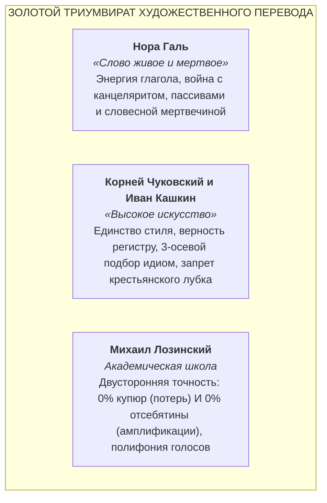
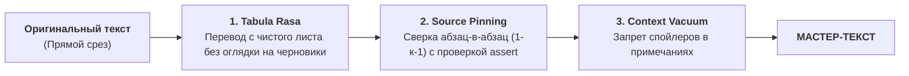
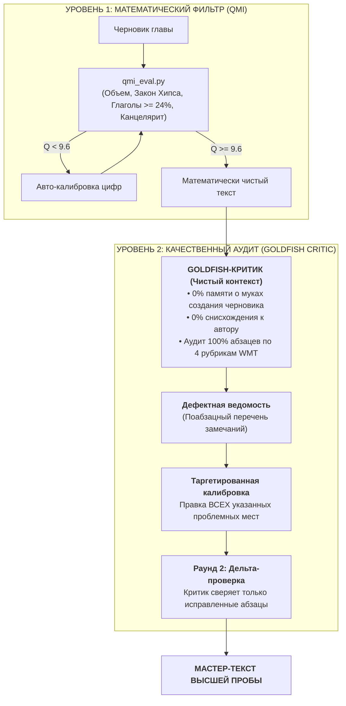

# Золотой канон художественного перевода для ИИ-агентов (Classic Russian Translation)

[](LICENSE)
[](#4-математическая-система-оценки-качества-quality-mastery-index-qmi)
[-orange.svg)](#9-двухуровневая-система-верификации-qmi--goldfish-critic)
[](#5-типологические-коридоры-языков-оригинала)
[](#2-золотой-триумвират-отечественной-школы)

**Универсальный методологический свод, просодический кодекс, система метрической валидации (Quality Mastery Index — QMI) и протокол независимого рецензирования (Goldfish Critic) для автономных ИИ-агентов, воссоздающих мировую классическую литературу на русском языке.**

---

## 1. Зачем создан этот проект?

Современные большие языковые модели (LLM) при стандартных системных промптах генерируют механический, стилистически выхолощенный подстрочник. В художественной литературе это приводит к трем системным дефектам:
1. **Канцелярит и номинализация:** рефлекторная замена живого действия отглагольными существительными (*«произвел выстрел»* вместо *«выстрелил»*, *«испытывал чувство страха»* вместо *«страшился»*).
2. **Трусливое ханжество (Sanitization / RLHF-стерилизация):** сглаживание боли, классовой ярости, плоти, физиологии и обсценной лексики оригинала под корпоративные стандарты деловой переписки.
3. **Рабская синтаксическая калька:** перенос жесткого прямого порядка слов (SVO) в русский текст, разрушающий естественное смысловое ударение (Тему и Рему) и ритм фразы.

**Настоящий репозиторий решает эту проблему на трех взаимосвязанных уровнях:**
* **Текстологический кодекс (`AGENTS.md`):** исчерпывающий системный регламент для ИИ-агента (Antigravity, Cursor, Claude Code, Windsurf), превращающий его из транслятора в полноправного писателя русской школы художественного перевода.
* **Математический контролер качества (`qmi_eval.py` / Уровень 1):** параметрическая 10-балльная система экспресс-оценки текста, выявляющая купюры, канцелярит и словарную бедность на основе законов корпусной лингвистики.
* **Протокол Goldfish-Критика (Уровень 2):** методология независимого качественного рецензирования изолированным субагентом без «авторской слепоты» по 4 критериям WMT Literary (тембр автора, перенос метафор, просодия, чистота эпохи).

---

## 2. Золотой триумвират отечественной школы

В основу Канона положены принципы трех непререкаемых классиков отечественного перевода:



### 2.1. Канон Норы Галь (Энергия глагола)
* **Мускулистое действие:** сжатие расщепленных сказуемых в упругий глагол (*«находился в состоянии опьянения»* $\rightarrow$ *«упился / был пьян»*).
* **Искоренение мертвого фонда:** тотальный запрет на слова-паразиты: *является, являлся, имел место, данный, некий, со стороны, в отношении, в плане, факт того что*.
* **Ликвидация судейских пассивов:** замена страдательного залога активным (*«Дверь была открыта ветром»* $\rightarrow$ *«Ветер распахнул дверь»*).

### 2.2. Канон Корнея Чуковского (Стиль стилем)
* **Идиоматическая эквивалентность по трем осям:**
  1. *Экспрессивный заряд:* совпадение по силе метафоры;
  2. *Стилистический регистр:* улица к улице, салон к салону;
  3. *Исторический хронотоп:* запрет советских или современных штампов (*«на хайпе»*, *«ударник труда»*) в классике XIX — середины XX века.
* **Запрет квази-русского лубка:** категорически запрещено переводить чужой социальный или этнический диалект (AAVE, кокни) псевдорусским суздальским просторечием (*«гой еси»*, *«кумекать»*, *«барин»*). Истинный диалект передается через нарушения грамматики, эллипсисы, фонетические стяжки (*«щас»*, *«глянь»*) и рваный темп.

### 2.3. Канон Михаила Лозинского (Двусторонняя полнота)
* **0% купюр:** ни одно авторское сравнение, эпитет или придаточное не могут быть выброшены.
* **0% амплификации (отсебятины):** переводчик не соавтор. Запрещено дописывать детали, навешивать красивости, разжевывать метафоры или вставлять в перевод будущий сюжетный контекст (Context Bleed).

---

## 3. Операционные принципы агента



1. **Принцип суверенного чистого листа (The Tabula Rasa Principle):**  
   Перевод создается исключительно с авторского первоисточника. Запрещено «редактировать» старые машинные черновики или компилировать чужие переводы — это ведет к наследованию скрытых галлюцинаций.
2. **Тотальный запрет на работу «по памяти» (The Source Pinning Principle):**  
   Каждый абзац считывается напрямую «в упор» по строгому индексу. Автоматический сборочный скрипт обязан проверять соответствие посимвольным assert-ом.
3. **Принцип контекстного вакуума (Context Vacuum):**  
   В комментариях и примечаниях строжайше запрещено раскрывать сюжетные повороты, мотивы и судьбы героев, о которых читатель оригинала в данной точке книги еще не знает.

---

## 4. Математическая система оценки качества: Quality Mastery Index (QMI)

Вместо субъективных ощущений первичное качество текста оценивается объективной **10-балльной системой QMI**, учитывающей типологию языка оригинала.

### 4.1. Почему «сырые» метрики вводят в заблуждение?
* **Закон Ципфа — Хипса:** отношение уникальных слов к общему объему ($V = k N^\beta$, где $\beta \approx 0.65–0.75$) нелинейно. На короткой главе в 2 000 слов коэффициент уникальности в русском тексте составляет 1.38x, а на всем романе в 170 000 слов — 3.20x. Прямое сравнение сырых цифр главы со всем романом порождает ложное впечатление недожима.
* **Типология языков:** синтетический русский язык без артиклей закономерно короче аналитического английского, но при переводе с немецкого (где слова склеены в *Komposita*) объем слов почти равен 1-к-1.

### 4.2. Математические формулы субиндексов (шкала 0.0 – 10.0)

#### 1. Индекс полноты Лозинского ($S_{\text{vol}}$)
Оценивает отношение числа слов русского текста к оригиналу:
$$R_w = \frac{N_{\text{ru}}}{N_{\text{src}}}$$

Функция оценки построена по принципу гладкого трапециевидного плато:
$$S_{\text{vol}} = \begin{cases} 
10.0, & \text{если } R_{\min} \le R_w \le R_{\max} \\
\max\left(3.0, 10.0 - 2.0 \cdot \frac{R_{\min} - R_w}{R_{\min} - R_{\text{warn\_low}}}\right), & \text{если } R_w < R_{\min} \quad (\text{штраф за купюры}) \\
\max\left(3.0, 10.0 - 2.0 \cdot \frac{R_w - R_{\max}}{R_{\text{warn\_high}} - R_{\max}}\right), & \text{если } R_w > R_{\max} \quad (\text{штраф за отсебятину и воду})
\end{cases}$$

#### 2. Индекс богатства словаря ($S_{\text{lex}}$)
Рассчитывает отношение уникальных русских слов к уникальным словам оригинала $R_u = \frac{U_{\text{ru}}}{U_{\text{src}}}$. Целевой порог $U^*(N)$ масштабируется по закону Ципфа — Хипса:
$$U^*(N) = U_{\text{base}} + 0.04 \cdot \ln\left(\max\left(1.0, \frac{N_{\text{src}}}{1000}\right)\right)$$

$$S_{\text{lex}} = \begin{cases} 
10.0, & \text{если } R_u \ge U^*(N) \\
\max\left(4.0, 10.0 - 20.0 \cdot (U^*(N) - R_u)^2\right), & \text{если } R_u < U^*(N)
\end{cases}$$

#### 3. Индекс энергии глагола Норы Галь ($S_{\text{verb}}$)
Измеряет долю предикатов и деепричастий в русском тексте:
$$P_{\text{verb}} = \frac{N_{\text{verbs}} + N_{\text{participles}}}{N_{\text{ru}}} \times 100\%$$

$$S_{\text{verb}} = \begin{cases} 
10.0, & \text{если } P_{\text{verb}} \ge 24.0\% \\
9.5 + (P_{\text{verb}} - 22.0) \cdot 0.25, & \text{если } 22.0\% \le P_{\text{verb}} < 24.0\% \\
8.5 + (P_{\text{verb}} - 20.0) \cdot 0.50, & \text{если } 20.0\% \le P_{\text{verb}} < 22.0\% \\
\max\left(3.0, 8.5 - (20.0 - P_{\text{verb}}) \cdot 0.80\right), & \text{если } P_{\text{verb}} < 20.0\%
\end{cases}$$

#### 4. Индекс стилистической чистоты ($S_{\text{purity}}$)
Базовый балл 10.0 с дифференцированными вычетами за мусорные конструкции:
$$S_{\text{purity}} = \max\left(0.0, 10.0 - 2.0 \cdot C_{\text{канцелярит}} - 0.2 \cdot \max(0, C_{\text{пассив}} - 5) - 0.2 \cdot \max(0, C_{\text{калька}} - 2)\right)$$

### 4.3. Интегральный показатель качества ($Q_{\text{total}}$)
$$Q_{\text{total}} = 0.25 \cdot S_{\text{vol}} + 0.30 \cdot S_{\text{lex}} + 0.25 \cdot S_{\text{verb}} + 0.20 \cdot S_{\text{purity}}$$

---

## 5. Типологические коридоры языков оригинала

| Язык источника | Типологический строй | Оптимальный коридор $R_w$ | Базовый $U_{\text{base}}$ | Лингвистическое обоснование |
| :---: | :---: | :---: | :---: | :--- |
| **EN (Английский)** | Аналитический | `0.81 – 0.92` | `1.35` | Синтетические русские окончания заменяют артикли (*the, a*) и глаголы-связки. Естественное сжатие на 8–19%. |
| **DE (Немецкий)** | Синтетический | `0.92 – 1.05` | `1.15` | Немецкие сложные существительные (*Handschuh, Schadenfreude*) при переводе распадаются на 2–3 русских слова. Соотношение близко к 1:1. |
| **FR (Французский)** | Аналитический (романский) | `0.73 – 0.86` | `1.30` | Обилие приглагольных клитик и частиц (*«Il me l'a dit»* $\rightarrow$ *«Он сказал мне это»*). Естественное сжатие на 14–27%. |

---

## 6. Академическая шкала соответствия Канону

Вместо эмоциональных субъективных терминов введена профессиональная классификационная шкала:

| Диапазон QMI | Статус соответствия | Описание |
| :---: | :---: | :--- |
| **9.6 – 10.0** | 🌟 **Канонический уровень (Эталон)** | Идеальное соответствие канону русской словесности: максимальная полнота, богатый словарь, безупречный ритм глагола и ноль канцелярита. |
| **9.0 – 9.5** | ✅ **Корректный уровень (Высокий стандарт)** | Высокий уровень мастерства. Канон соблюден, допустимы точечные косметические микрошлифовки. |
| **8.0 – 8.9** | ⚠️ **Требует калибровки (Зона недожима)** | Локальные просадки: увлечение пассивами, провисание глагольности или легкие смысловые сокращения. Требует повторного прохода. |
| **< 8.0** | ❌ **Несоответствие канону (Брак)** | Системный сбой: смысловые купюры, машинная сухость, канцелярит или синтаксические кальки. Текст отправляется на полную переработку. |

---

## 7. Практическая верификация: Роман «Невидимка» (Ralph Ellison, 1952)

Ниже приведены реальные результаты прогона инструмента `qmi_eval.py` по главам романа Ральфа Эллисона:

| Раздел / Глава | Полнота ($S_{\text{vol}}$) | Словарь ($S_{\text{lex}}$) | Глагол ($S_{\text{verb}}$) | Чистота ($S_{\text{purity}}$) | ИТОГ QMI | Статус соответствия | Метод перевода |
| :--- | :---: | :---: | :---: | :---: | :---: | :---: | :---: |
| **ПРОЛОГ** | 10.0/10 | 10.0/10 | 10.0/10 | 9.8/10 | **10.0 / 10** | 🌟 Канонический уровень | Золотой Канон (Tabula Rasa) |
| **CHAPTER 1** | 10.0/10 | 10.0/10 | 10.0/10 | 10.0/10 | **10.0 / 10** | 🌟 Канонический уровень | Золотой Канон (Tabula Rasa) |
| **CHAPTER 2** | 10.0/10 | 10.0/10 | 10.0/10 | 9.6/10 | **9.9 / 10** | 🌟 Канонический уровень | Золотой Канон (Tabula Rasa) |
| **CHAPTER 3** | 10.0/10 | 10.0/10 | 9.8/10 | 10.0/10 | **9.9 / 10** | 🌟 Канонический уровень | Золотой Канон (Tabula Rasa) |
| *CHAPTER 4 (черновик)* | 5.1/10 | 10.0/10 | 10.0/10 | 9.8/10 | **8.7 / 10** | ⚠️ Требует калибровки | Старый черновик (купюры) |
| *CHAPTER 5 (черновик)* | 10.0/10 | 10.0/10 | 9.0/10 | 2.2/10 | **8.2 / 10** | ⚠️ Требует калибровки | Старый черновик (канцелярит) |
| *CHAPTER 18 (черновик)* | 9.1/10 | 10.0/10 | 10.0/10 | 2.8/10 | **8.3 / 10** | ⚠️ Требует калибровки | Старый черновик (канцелярит) |

---

## 8. Использование консольного инструмента `qmi_eval.py`

Репозиторий включает готовый инструмент оценки качества для Python 3.8+:

```bash
# Оценка перевода с английского оригинала
python qmi_eval.py --file translated_book.json --lang EN

# Оценка перевода с немецкого или французского
python qmi_eval.py --file german_novel.json --lang DE
python qmi_eval.py --file proust.json --lang FR

# Выгрузка отчета в формате JSON для CI/CD-конвейеров
python qmi_eval.py --file translated_book.json --lang EN --json
```

---

## 9. Двухуровневая система верификации: QMI + Goldfish Critic

Высшее качество художественной литературы обеспечивается синергией математического фильтра и независимой качественной экспертизы:



### 4 качественные рубрики Goldfish-Критика (WMT Literary):
1. **$J_{\text{voice}}$ (Тембр и идиостиль):** сохранение уникального авторского регистра (телеграфный модернизм Хемингуэя, симфонический период Фолкнера, гротескная сатира Селина или Эллисона);
2. **$J_{\text{meta}}$ (Перенос метафор):** сохранение образного удара тропов без плоского пословного буквализма;
3. **$J_{\text{prosody}}$ (Просодия и синтаксис):** правильное русское движение от Темы к Реме, естественная каденция и тест на чтение вслух;
4. **$J_{\text{chronotope}}$ (Чистота эпохи):** фильтрация терминологических анахронизмов XXI века и советских штампов.

### Регламент взаимодействия:
* **Сплошной охват:** проверяются **100% абзацев главы**. Правятся **все без исключения абзацы**, к которым у критика возникли претензии (будь их 3 или 45).
* **Системный сбой ($>30\%$ замечаний или балл $<8.0$):** точечные заплатки запрещены — глава переводится заново с чистого листа.
* **Предохранитель (Circuit Breaker):** строго максимум 2 раунда взаимодействия во избежание «синдрома зализывания» живой прозы.

---

## 10. Как подключить Канон к своему ИИ-агенту

1. Скопируйте файл [`AGENTS.md`](AGENTS.md) в корень вашего проекта.
2. В системном промпте или правилах агента (Antigravity `.gemini/rules`, Cursor `.cursorrules`, Claude Code `CLAUDE.md`) укажите:
   ```markdown
   Все переводы художественной литературы выполнять в строгом соответствии с каноном в файле AGENTS.md.
   ```
3. Перед утверждением главы запускайте Уровень 1 (`python qmi_eval.py --file book.json --lang EN`), а затем независимого субагента для Уровня 2 (Goldfish Critic по Разделу 9).

---

## 11. Структура репозитория

* **[`AGENTS.md`](AGENTS.md)** — Полный текст Золотого Канона: писательский свод, метрики QMI и протокол Goldfish-Критика.
* **[`qmi_eval.py`](qmi_eval.py)** — Математический скрипт валидации по формулам QMI v1.3.0.
* **[`LICENSE`](LICENSE)** — Лицензия MIT.

---

## Лицензия

Распространяется под свободной лицензией [MIT](LICENSE). Разрешено свободное использование в некоммерческих и коммерческих проектах литературного перевода при сохранении ссылки на авторство Золотого Канона.
