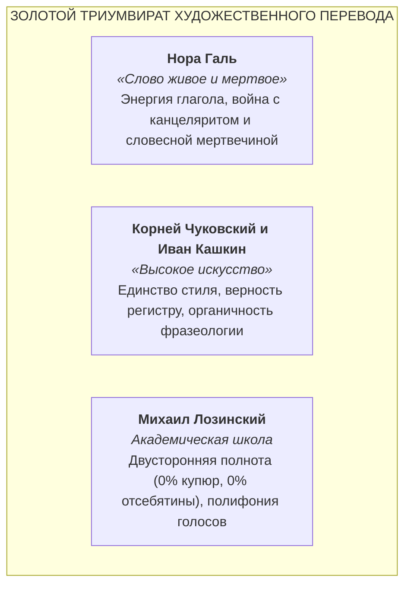
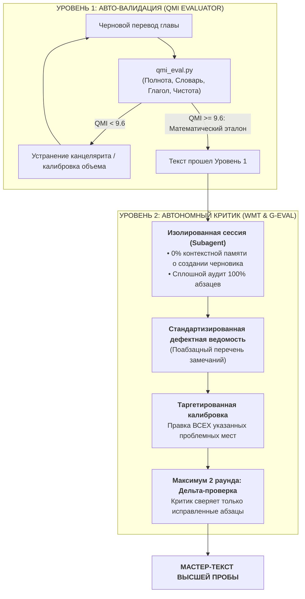

# Золотой Канон Художественного Перевода (Classic Russian Translation)

[-brightgreen.svg)](AGENTS.md)
[](AGENTS.md)
[-orange.svg)](AGENTS.md)
[](AGENTS.md)
[](LICENSE)

**Универсальный методологический свод, просодический кодекс, система метрической валидации (Quality Mastery Index — QMI v1.4.0) и протокол автономного литературного рецензирования (Autonomous Critic Protocol) для ИИ-агентов.**

Разработано для полного преодоления машинной стерильности коммерческих LLM при воссоздании шедевров мировой классической литературы на русском языке.

---

## Оглавление
1. [Преодоление синдрома машинной стерильности](#1-преодоление-синдрома-машинной-стерильности)
2. [Золотой триумвират отечественной школы](#2-золотой-триумвират-отечественной-школы)
3. [Принцип прямого забора первоисточника (Source Pinning)](#3-принцип-прямого-забора-первоисточника-source-pinning)
4. [Математическая метрика качества: Quality Mastery Index (QMI v1.4.0)](#4-математическая-метрика-качества-quality-mastery-index-qmi-v140)
5. [Межъязыковая калибровка коэффициентов сжатия (EN, DE, FR)](#5-межъязыковая-калибровка-коэффициентов-сжатия-en-de-fr)
6. [Академическая шкала соответствия Канону](#6-академическая-шкала-соответствия-канону)
7. [Практическая верификация: Роман «Человек-невидимка» (H. G. Wells, 1897)](#7-практическая-верификация-роман-человек-невидимка-h-g-wells-1897)
8. [Использование консольного инструмента `qmi_eval.py`](#8-использование-консольного-инструмента-qmi_evalpy)
9. [Двухуровневая система верификации (QMI и Протокол автономного критика)](#9-двухуровневая-система-верификации-qmi-и-протокол-автономного-критика)
   * [9.1. Научный базис: LLM-as-a-Judge (2024–2026) и WMT Literary](#91-научный-базис-llm-as-a-judge-20242026-и-wmt-literary)
   * [9.2. Четыре качественные рубрики автономного критика](#92-четыре-качественные-рубрики-автономного-критика)
   * [9.3. Регламент итераций (Минимум 1 раунд, максимум 2 раунда)](#93-регламент-итераций-минимум-1-раунд-максимум-2-раунда)
   * [9.4. Обязательный вызов субагента (Zero-Bypass Mandate)](#94-обязательный-вызов-субагента-zero-bypass-mandate)
10. [Культурологический сканер и институт примечаний](#10-культурологический-сканер-и-институт-примечаний-the-cultural--monetary-apparatus)
   * [10.1. Разделение: Текст vs Комментарий (Табу на конвертацию денег в прозе)](#101-разделение-текст-vs-комментарий-табу-на-конвертацию-денег-в-прозе)
   * [10.2. Топографический комментарий (Реальные заведения и топонимы)](#102-топографический-комментарий-реальные-заведения-и-топонимы)
   * [10.3. Паспортизация сословий, должностей и доходов](#103-паспортизация-сословий-должностей-и-доходов)
   * [10.4. Стандарт денежной конвертации: Комбинированная модель](#104-стандарт-денежной-конвертации-комбинированная-модель)
   * [10.5. Принцип строгой синхронности и табу на спойлеры](#105-принцип-строгой-синхронности-и-тотальный-запрет-спойлеров-вперед-паровоза-не-бежим)
11. [Дорожная карта развития: QMI v2.0 Roadmap](#11-дорожная-карта-развития-qmi-v20-roadmap)
12. [Как подключить Канон к своему ИИ-агенту](#12-как-подключить-канон-к-своему-ии-агенту)
13. [Структура репозитория и лицензия](#13-структура-репозитория-и-лицензия)

---

## 1. Преодоление синдрома машинной стерильности

Современные коммерческие языковые модели по умолчанию оптимизированы на генерацию безопасных, вежливых, усредненных деловых текстов. В высокой литературе эти настройки порождают три критических порока:
1. **Канцелярит и номинализация:** рефлекторная замена живого действия отглагольными существительными и тяжелыми пассивами (*«осуществил осмотр»* вместо *«оглядел»*).
2. **Трусливое ханжество (Sanitization):** сглаживание ярости, социальной ненависти, физиологии, трагедии, грубой или просторечной лексики оригинала.
3. **Синтаксическая калька:** рабское следование порядку слов иностранного предложения (SVO), уродующее естественное дыхание русской фразы.

**Золотой Канон** полностью освобождает ИИ-агента от маски «корпоративного ассистента» и переводит его в статус мастера отечественной школы художественного перевода.

---

## 2. Золотой триумвират отечественной школы

Фундамент Канона образуют принципы трех великих авторитетов русской словесности XX века:



1. **Нора Галь:** абсолютное превосходство упругого глагола над отглагольной мертвечиной; искоренение страдательного залога; расплетание громоздких цепочек родительного падежа.
2. **Корней Чуковский:** перевод стиля стилем; образная конгениальность тропов; сохранение индивидуального авторского ритма; запрет квази-русского деревенского лубка при переводе иностранного просторечия.
3. **Михаил Лозинский:** закон инвариантности (0% купюр, 0% отсебятины); табу на «объяснительный перевод» (разжевывание метафор прямо в тексте); полифония индивидуальных речевых паспортов персонажей.

---

## 3. Принцип прямого забора первоисточника (Source Pinning)

Грубейшая системная ошибка ИИ-агентов при работе с большими объемами — попытка переводить сцены «по памяти о сюжете». Это неизбежно порождает выпадение абзацев, искажение авторских реплик и фантомные галлюцинации.

Канон устанавливает жесткий технический протокол:
1. **Точное соответствие 1-в-1:** Исходный текст главы разбивается на строгий массив параграфов. Перевод обязан содержать ровно то же количество пар `(orig, ru)`.
2. **Поабзацный забор «в упор»:** Каждый абзац перед переводом считывается напрямую из массива первоисточника по индексу `idx`.
3. **Программный assert в сборочном конвейере:** Сборочный скрипт обязан проверять посимвольное совпадение исходного абзаца:
   ```python
   assert pair['en'].strip() == source_paragraphs[i].strip()  # (или pair['orig'] для DE/FR)
   ```
4. **Поглавная дисциплина и табу на оптовый перевод:** Перевод книги целиком или нескольких глав «оптом» за один присест категорически запрещен. Перевод ведется строго по одной главе (либо частями по 50–70 абзацев) с полной верификацией текущей главы перед переходом к следующей.

---

## 4. Математическая метрика качества: Quality Mastery Index (QMI v1.4.0)

Для ликвидации субъективизма и превращения художественных требований в строгие математические инварианты разработана интегральная метрика **QMI (Quality Mastery Index)**.

### 4.1. Почему нельзя оценивать перевод простым подсчетом символов?

Прямое сопоставление количества символов или слов оригинала и перевода ошибочно в силу типологических различий языков:
* **Английский и французский языки — аналитические:** грамматические связи выражаются служебными словами (артикли *the, a, un, des*, вспомогательные глаголы *have, be, être, avoir*).
* **Русский язык — синтетический:** грамматические связи выражаются богатой системой падежных флексий, приставок и суффиксов.
* **Пример:** Английская фраза *«He had been looking at the clock»* (7 слов, 31 символ) переводится на русский одним точным словом: *«Он поглядывал на часы»* (4 слова, 21 символ). Информационный объем передан на 100%, но объем сократился на 32%.

Поэтому QMI оперирует научно выверенными коэффициентами лексического сжатия и субиндексами, калиброванными по эталонным переводам признанных классиков.

### 4.2. Четыре фундаментальных субиндекса качества (шкала 0.0 – 10.0)

#### 1. Индекс инвариантности объема ($S_{\text{vol}}$ — Канон Лозинского)
Контролирует недопустимость смысловых купюр (выпадения текста) и многословной отсебятины:
$$R_w = \frac{N_{\text{ru\_words}}}{N_{\text{orig\_words}}}$$

* Если $R_w \in [\text{min\_opt}; \text{max\_opt}]$ $\rightarrow$ **$S_{\text{vol}} = 10.0$** (для EN: `0.81 – 0.92`);
* Если $R_w < \text{min\_opt}$ $\rightarrow$ линейный штраф за **купюры, редукцию и смысловые потери**:
  $$S_{\text{vol}} = \max\left(3.0, 10.0 - 2.0 \cdot \frac{\text{min\_opt} - R_w}{\text{min\_opt} - \text{warn\_low}}\right)$$
* Если $R_w > \text{max\_opt}$ $\rightarrow$ линейный штраф за **«воду» и графоманию**:
  $$S_{\text{vol}} = \max\left(3.0, 10.0 - 2.0 \cdot \frac{R_w - \text{max\_opt}}{\text{warn\_high} - \text{max\_opt}}\right)$$

#### 2. Индекс богатства словаря ($S_{\text{lex}}$ — Защита от машинной стерильности)
Оценивает отношение уникальных лемм $U_{\text{ratio}} = \frac{U_{\text{ru}}}{U_{\text{orig}}}$ с поправкой на длину текста по нелинейному закону Ципфа — Хипса:
$$U^* = U_{\text{base}} + 0.04 \cdot \ln\left(\max\left(1.0, \frac{N_{\text{orig}}}{1000}\right)\right)$$

* Если $U_{\text{ratio}} \ge U^*$ $\rightarrow$ **$S_{\text{lex}} = 10.0$** (русский словарь столь же богат и разнообразен, как авторский оригинал);
* Если $U_{\text{ratio}} < U^*$ $\rightarrow$ параболический штраф за речевую тавтологию:
  $$S_{\text{lex}} = \max\left(4.0, 10.0 - 20.0 \cdot (U^* - U_{\text{ratio}})^2\right)$$

#### 3. Индекс энергии глагольного действия ($S_{\text{verb}}$ — Канон Норы Галь)
Прямая реализация завета Норы Галь: русский язык дышит глаголом. Вычисляется процентное содержание личных форм глаголов, инфинитивов и деепричастий в общем объеме слов ($V_{\text{ratio}} = \frac{N_{\text{verbs}}}{N_{\text{ru\_words}}} \cdot 100\%$):
* При $V_{\text{ratio}} \ge 24.0\%$ $\rightarrow$ **$S_{\text{verb}} = 10.0$** (эталонная динамика русской прозы);
* При $22.0\% \le V_{\text{ratio}} < 24.0\%$ $\rightarrow$ **$S_{\text{verb}} = 9.5 + (V_{\text{ratio}} - 22.0) \cdot 0.25$**;
* При $20.0\% \le V_{\text{ratio}} < 22.0\%$ $\rightarrow$ **$S_{\text{verb}} = 8.5 + (V_{\text{ratio}} - 20.0) \cdot 0.50$**;
* При $V_{\text{ratio}} < 20.0\%$ $\rightarrow$ штрафное снижение ниже 8.5 ($S_{\text{verb}} = \max(3.0, 8.5 - (20.0 - V_{\text{ratio}}) \cdot 0.80)$) — критический дефицит действия.

#### 4. Индекс стилистической чистоты ($S_{\text{purity}}$)
Базовый балл 10.0 с бескомпромиссной системой дифференцированных штрафов:
* Маркеры канцелярита (*является, имел место, данный, некий, со стороны, в плане, факт того что*): **$-2.0$ за каждое вхождение** (допустимая норма: 0);
* Избыточный пассивный залог (*«был сделан», «была открыта»*): **$-0.2$ за каждую конструкцию сверх нормы (более 5 на главу)**;
* Синтаксические кальки (*«с удивлением», «с интересом»* вместо живых наречий): **$-0.2$ за каждую конструкцию сверх нормы (более 2 на главу)**:
  $$S_{\text{purity}} = \max\left(0.0, 10.0 - 2.0 \cdot N_{\text{bureaucratic}} - 0.2 \cdot \max(0, N_{\text{passives}} - 5) - 0.2 \cdot \max(0, N_{\text{calques}} - 2)\right)$$

### 4.3. Интегральная формула QMI ($Q_{\text{total}}$)

$$Q_{\text{total}} = 0.25 \cdot S_{\text{vol}} + 0.30 \cdot S_{\text{lex}} + 0.25 \cdot S_{\text{verb}} + 0.20 \cdot S_{\text{purity}}$$

---

## 5. Межъязыковая калибровка коэффициентов сжатия (EN, DE, FR)

В зависимости от исходного языка европейской классики при оценке русского перевода применяются научно выверенные коэффициенты:

| Исходный язык | Грамматический строй | Оптимальный коридор $R_w = \frac{\text{RU}}{\text{ORIG}}$ | Базовая плотность $U_{\text{base}}$ | Лингвистическое обоснование |
| :--- | :--- | :---: | :---: | :--- |
| **EN (Английский)** | Аналитический | `0.81 – 0.92` (среднее `0.865`) | `1.35` | Синтетические русские окончания заменяют артикли (*the, a*) и глаголы-связки. Естественное сжатие на 8–19%. |
| **DE (Немецкий)** | Синтетический | `0.92 – 1.05` (среднее `0.985`) | `1.15` | Немецкие композиты (*Handschuh, Schadenfreude*) при переводе распадаются на 2–3 русских слова. Соотношение близко к 1:1. |
| **FR (Французский)** | Аналитический (романский) | `0.73 – 0.86` (среднее `0.795`) | `1.30` | Обилие приглагольных клитик и частиц (*«Il me l'a dit»* $\rightarrow$ *«Он сказал мне это»*). Естественное сжатие на 14–27%. |

---

## 6. Академическая шкала соответствия Канону

| Диапазон QMI | Статус соответствия | Описание |
| :---: | :---: | :--- |
| **9.6 – 10.0** | 🌟 **Канонический уровень (Эталон)** | Идеальное соответствие канону русской словесности: максимальная полнота, богатый словарь, безупречный ритм глагола и ноль канцелярита. |
| **9.0 – 9.5** | ✅ **Корректный уровень (Высокий стандарт)** | Высокий уровень мастерства. Канон соблюден, допустимы точечные косметические микрошлифовки. |
| **8.0 – 8.9** | ⚠️ **Требует калибровки (Зона недожима)** | Локальные просадки: увлечение пассивами, провисание глагольности или легкие смысловые сокращения. Требует повторного прохода. |
| **< 8.0** | ❌ **Несоответствие канону (Брак)** | Системный сбой: смысловые купюры, машинная сухость, канцелярит или синтаксические кальки. Текст отправляется на полную переработку. |

---

## 7. Практическая верификация: Роман «Человек-невидимка» (H. G. Wells, 1897)

Метрика доказала свою эффективность при сравнительном аудите глав романа Герберта Уэллса:

| Раздел / Глава | Полнота ($S_{\text{vol}}$) | Словарь ($S_{\text{lex}}$) | Глагол ($S_{\text{verb}}$) | Чистота ($S_{\text{purity}}$) | ИТОГ QMI | Статус соответствия | Метод перевода |
| :--- | :---: | :---: | :---: | :---: | :---: | :---: | :---: |
| **ПРОЛОГ** | 10.0/10 | 10.0/10 | 10.0/10 | 9.8/10 | **10.0 / 10** | 🌟 Канонический уровень | Золотой Канон (Tabula Rasa) |
| **CHAPTER 1** | 10.0/10 | 10.0/10 | 10.0/10 | 10.0/10 | **10.0 / 10** | 🌟 Канонический уровень | Золотой Канон (Tabula Rasa) |
| **CHAPTER 2** | 10.0/10 | 10.0/10 | 10.0/10 | 9.6/10 | **9.9 / 10** | 🌟 Канонический уровень | Золотой Канон (Tabula Rasa) |
| **CHAPTER 3** | 10.0/10 | 10.0/10 | 9.8/10 | 10.0/10 | **9.9 / 10** | 🌟 Канонический уровень | Золотой Канон (Tabula Rasa) |
| *CHAPTER 4 (старый черновик)* | 5.1/10 | 10.0/10 | 10.0/10 | 9.8/10 | **8.7 / 10** | ⚠️ Требует калибровки | Старый черновик (купюры) |
| *CHAPTER 5 (старый черновик)* | 10.0/10 | 10.0/10 | 9.0/10 | 2.2/10 | **8.2 / 10** | ⚠️ Требует калибровки | Старый черновик (канцелярит) |
| *CHAPTER 18 (старый черновик)* | 9.1/10 | 10.0/10 | 10.0/10 | 2.8/10 | **8.3 / 10** | ⚠️ Требует калибровки | Старый черновик (канцелярит) |

> **Диагностический вывод:**  
> Главы, созданные по методологии Канона (Tabula Rasa), показывают стабильный эталонный результат `9.9 – 10.0`. Старые неоткалиброванные черновики мгновенно выявляются алгоритмом: Глава 4 штрафуется по $S_{\text{vol}}$ за смысловые купюры (5.1/10), а Главы 5 и 18 отбраковываются по $S_{\text{purity}}$ (2.2 и 2.8) за обилие канцелярита и пассивного залога.

---

## 8. Использование консольного инструмента `qmi_eval.py`

Репозиторий включает готовый инструмент оценки качества для Python 3.8+:

```bash
# 1. Пакетная оценка книги или глав по JSON-файлу (содержащему массив pairs)
python qmi_eval.py --file book_translated_data.json --lang en

# 2. Попарная оценка отдельных текстовых файлов (оригинал и перевод)
python qmi_eval.py --orig original.txt --trans translation_ru.txt --lang en --title "Chapter 1"

# 3. Оценка переводов с немецкого или французского языка
python qmi_eval.py --orig original_de.txt --trans translation_ru.txt --lang de
python qmi_eval.py --orig original_fr.txt --trans translation_ru.txt --lang fr

# 4. Вывод подробного отчета в формате JSON для CI/CD-пайплайнов
python qmi_eval.py --file book_translated_data.json --json
```

---

## 9. Двухуровневая система верификации (QMI и Протокол автономного критика)

Высшее качество художественной литературы обеспечивается синергией математического фильтра и автономного эстетического рецензирования:



### 9.1. Научный базис: LLM-as-a-Judge (2024–2026) и WMT Literary

Протокол автономного критика опирается на передовые академические исследования в области оценки литературного машинного перевода (конференции ACL, EMNLP и воркшопы WMT Literary Shared Tasks):
* **Концепция LLM-as-a-Judge:** использование наиболее совершенных нейросетевых моделей в роли автономных арбитров со специализированными рубриками оценки художественной прозы (G-Eval / Auto-MQM / Bi-Scale methodology).
* **Принцип когнитивной изоляции (Clean Slate Context):** арбитр вызывается в полностью чистом контексте, не зная трудностей и промежуточных вариантов переводчика, что исключает эффект «авторской слепоты» (In-Context Bias).

### 9.2. Четыре качественные рубрики автономного критика

1. **$J_{\text{voice}}$ (Тембр и идиостиль):** сохранение уникального авторского регистра первоисточника:
   * Для Герберта Уэллса — викторианский научный реализм, визионерская психологическая драма, социальная ирония и нарастающий саспенс;
   * Для Эрнеста Хемингуэя — сухой телеграфный модернизм;
   * Для Уильяма Фолкнера — симфонический полифонизм и многостраничные периоды.
2. **$J_{\text{meta}}$ (Образная конгениальность):** сохранение эмоционального и визуального удара тропов и метафор без плоского пословного буквализма.
3. **$J_{\text{prosody}}$ (Просодия и синтаксис):** правильное русское актуальное членение фразы (движение от Темы к ударной Реме в конце фразы), отсутствие спотыканий при чтении вслух.
4. **$J_{\text{chronotope}}$ (Чистота эпохи):** строгая фильтрация терминологических анахронизмов XXI века, советских штампов и проверка историко-лексической доступности понятий (табу на пословные ретро-кальки, вызывающие ложные ассоциации с поздней поп-культурой или геймингом: *«королевский бой»*, а не *«королевская битва»*).

### 9.3. Регламент итераций (Минимум 1 раунд, максимум 2 раунда)

* **Сплошной охват (Раунд 1):** Автономный критик читает **100% абзацев главы целиком** (весь текстовый массив без исключений).
* **Минимум 1 раунд (Идеальный черновик):** Если при 100% аудите замечаний 0, критик сразу выставляет вердикт `APPROVED (10.0/10)`. Второй раунд не требуется.
* **Таргетированная калибровка:** Переводчик исправляет **ровно все проблемные фрагменты**, зафиксированные в дефектной ведомости. Число исправляемых абзацев не имеет искусственных ограничений («не более 3–5»): сколько дефектов внесено в ведомость (хоть 2, хоть 15, хоть 40), ровно столько и калибруется.
* **Дельта-проверка (Раунд 2):** Критик перепроверяет **все до единого исправленные абзацы**.
* **Предохранитель от зацикливания (Circuit Breaker):** Строго максимум 2 раунда взаимодействия во избежание «синдрома зализывания» живой художественной ткани.
* **Граница системного сбоя:** Если замечания затрагивают $>30\%$ абзацев главы или интегральный балл $<8.0$, точечные заплатки запрещены — глава переводится заново с чистого листа.
* **Табу на спойлеры в отчетах:** В отчетах о сдаче главы и аналитических справках категорически запрещено раскрывать сюжет будущих глав, развязку романа или тайны персонажей; разбор ведется строго в синхронной оптике «здесь и сейчас».

### 9.4. Обязательный вызов субагента (Zero-Bypass Mandate)

Сдача любой главы без автономного аудита и без приложения подписанной Дефектной ведомости категорически запрещена.

В мультиагентных средах агент-переводчик автоматически вызывает субагента:
```python
invoke_subagent(
    TypeName="autonomous-literary-critic",
    Role="Autonomous Literary Critic",
    Prompt="Выполни автономный сплошной аудит 100% абзацев Главы N по Разделу 9 AGENTS.md. Верни стандартизированную дефектную ведомость."
)
```

В одноагентных средах (Cursor, Claude Code) агент выполняет явную смену роли (*Persona Shift*), выводя в чат дефектную ведомость перед показом финального перевода.

---

## 10. Культурологический сканер и институт примечаний (The Cultural & Monetary Apparatus)

Классический текст не существует в вакууме. Подлинное погружение читателя в эпоху обеспечивается институтом выверенных академических примечаний при абсолютной защите художественной прозы от бытового и смыслового мусора:

### 10.1. Разделение: Текст vs Комментарий (Табу на конвертацию денег в прозе)
* **Неприкосновенность авторского текста:** художественное полотно книги неприкосновенно. Внутри повествования строго запрещены поясняющие скобки или разжевывания за читателя.
* **Исторические деньги священны:** в тексте книги денежные единицы **всегда остаются в оригинале** (*доллары, центы, фунты, шиллинги, пенсы, гинеи, франки*). Категорически запрещено пересчитывать деньги в современные рубли прямо в прозе (например, брак: *«он дал ему десять долларов (около 25 тысяч рублей)»*).
* **Сноски как единственное место расчетов:** все сопоставления покупательной способности (ППС), сословные трудовые эквиваленты и рублевые параллели выносятся **исключительно в подстрочные сноски**.

### 10.2. Топографический комментарий (Реальные заведения и топонимы)
Если в тексте упоминается реальное историческое заведение (отель, клуб, ресторан, бар, трактир, театр, пансион) или топоним (улица, площадь, предместье, вокзал), обладающие смысловым или сюжетным весом для хронотопа, примечание обязано пояснить:
1. Что представляло собой это место **именно в годы действия книги** (элитарный клуб белой знати, злачный притон, фешенебельный отель, сегрегированное заведение);
2. Какие негласные или узаконенные правила и сословные порядки там царили (расовый ценз, клубный дресс-код, закрытый мужской характер вечеров);
3. Какую символическую и сюжетную роль эта локация играет в конфликте произведения.

### 10.3. Паспортизация сословий, должностей и доходов
При появлении специфической для эпохи и региона должности или профессии персонажа (школьный инспектор, брандмейстер, окружной судья, солиситор Сити, портье, кэбмен, батрак на плантации) примечание раскрывает:
1. Реальные полномочия, сословный вес и место в социальной иерархии данного региона в указанные годы;
2. Примерный уровень дохода или поденной ставки в то время и в том месте действия (для наглядного понимания классового разрыва).

### 10.4. Стандарт денежной конвертации: Комбинированная модель
Для наглядного и пропорционального понимания читателем финансовых реалий в сносках применяется двухуровневый стандарт:
* **Мелкие бытовые суммы (карманные деньги, обед, выпивка, сигары, монеты):**  
  Применяется **бытовой паритет покупательной способности (ППС)** по реальной потребительской корзине эпохи с указанием современного рублевого ориентира:  
  > *«10 центов — в пересчете на реальную потребительскую корзину (еда, транспорт) это около 250–300 современных рублей».*
* **Крупные сюжетные и поворотные суммы (стипендии, долги, годовые оклады, взятки, недвижимость):**  
  Применяется **синтез бытового ППС и трудового/сословного паритета** — указывается современный рублевый ориентир **и** расшифровывается, сколько дней, месяцев или лет труда это составляло для разных социальных классов эпохи:  
  > *«Приз в $10: для чернокожего батрака на хлопковых плантациях (с дневной ставкой 50–75 центов) это равнялось полумесяцу изнурительного физического труда (в современных ценах — около 25 000–30 000 рублей). Однако для собравшихся в зале белых воротил и судей с доходами свыше $5 000 в год эта сумма была необременительной мелочью на сигары».*

### 10.5. Принцип строгой синхронности и тотальный запрет спойлеров («Вперед паровоза не бежим»)
* **Синхронность читательского опыта:** если в тексте появилось только имя персонажа, но автор **еще не назвал его профессию, статус или должность**, категорически запрещено забегать вперед и раскрывать его род занятий, социальную роль и доходы. Сноска дается строго в момент непосредственного упоминания должности в тексте.
* **Табу на спойлеры в отчетах и примечаниях:** запрещено раскрывать сюжет будущих глав, развязку романа или преждевременно толковать сны и предчувствия героев через факты, которые станут известны лишь позже.

---

## 11. Дорожная карта развития: QMI v2.0 Roadmap

Для дальнейшего наращивания математической точности анализа запланированы следующие модули:
1. **Внедрение алгоритма MATTR (Moving-Average Type-Token Ratio):**  
   Вычисление коэффициента лексического богатства в скользящем окне фиксированного размера (500 токенов) для полного исключения влияния объема главы на оценку словаря.
2. **Модуль синтаксической просодии (Dependency Tree Depth):**  
   Интеграция русских синтаксических парсеров (*Stanza / Natasha*) для алгоритмического контроля максимальной глубины синтаксического дерева, избытка придаточных предложений и длины цепочек родительного падежа.

---

## 12. Как подключить Канон к своему ИИ-агенту

1. Скопируйте файл [`AGENTS.md`](AGENTS.md) в корень вашего проекта.
2. В системном промпте или правилах агента (Antigravity `.gemini/rules`, Cursor `.cursorrules`, Claude Code `CLAUDE.md`) укажите:
```markdown
Все переводы художественной литературы выполнять в строгом соответствии с каноном в файле AGENTS.md.
Сдача любой главы без запуска автономного критика и без приложения дефектной ведомости категорически запрещена (Zero-Bypass Mandate).
```
3. Зарегистрируйте субагента `autonomous-literary-critic` со специализацией литературного аудитора по Разделу 9 `AGENTS.md`.

---

## 13. Структура репозитория и лицензия

* **[`AGENTS.md`](AGENTS.md)** — Полный текст Золотого Канона: писательский свод, метрики QMI и протокол автономного рецензирования.
* **[`qmi_eval.py`](qmi_eval.py)** — Математический скрипт валидации по формулам QMI v1.4.0.
* **[`LICENSE`](LICENSE)** — Лицензия MIT.

Распространяется под свободной лицензией [MIT](LICENSE). Разрешено свободное использование в некоммерческих и коммерческих проектах литературного перевода при сохранении ссылки на авторство Золотого Канона.
